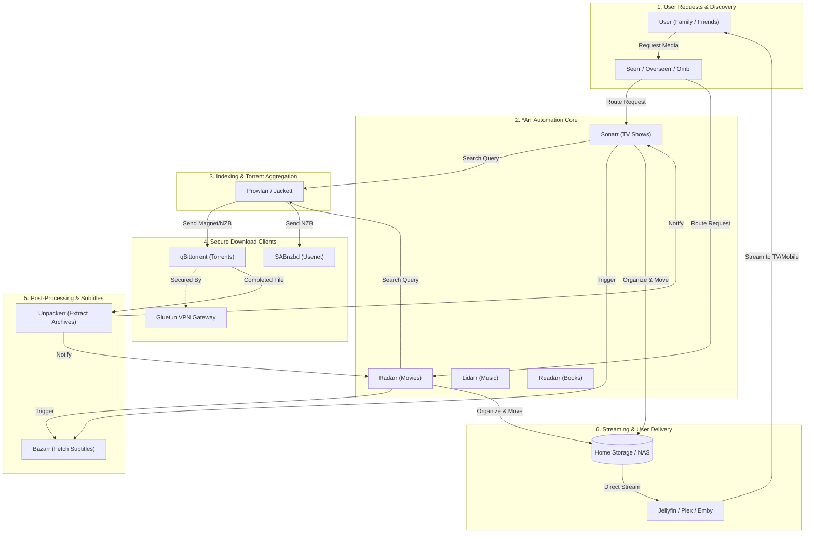

# Awesome Media Automation & Home Server Management

> A curated directory of premier SaaS platforms, commercial media servers, hosted seedbox providers, and self-hosted open-source tools powering the modern home server, homelab, and automated media acquisition ecosystem.

A comprehensive, SEO-optimized directory tracking notable **commercial SaaS / hosted platforms** and **open-source GitHub software** for **Media Automation & Home Server Management**. These tools automate the entire lifecycle of a personal media library—including torrent/Usenet acquisition, indexer aggregation, download client automation, automatic file renaming, metadata tagging, multi-language subtitle fetching, media transcoding, and household user request management (centering on the ubiquitous **\*Arr ecosystem**).

---

## Table of Contents

- [Sector Overview & Market Dynamics](#sector-overview--market-dynamics)
- [SaaS & Commercial Hosted Platforms](#saas--commercial-hosted-platforms)
- [Open-Source GitHub Projects](#open-source-github-projects)
  - [Core *Arr Suite & Multi-Service Managers](#core-arr-suite--multi-service-managers)
  - [Media Streaming & Private Cloud Servers](#media-streaming--private-cloud-servers)
  - [Dashboards, Request Portals & Homelab Infrastructure](#dashboards-request-portals--homelab-infrastructure)
  - [Indexer Proxies & Download Clients](#indexer-proxies--download-clients)
  - [Audio, E-Books & Specialized Library Managers](#audio-e-books--specialized-library-managers)
  - [Automation Helpers & Companion Tools](#automation-helpers--companion-tools)
- [Recommended Stack Architectures](#recommended-stack-architectures)
- [How to Contribute](#how-to-contribute)
- [Disclaimer](#disclaimer)

---

## Sector Overview & Market Dynamics

The global home media server and residential automation software sector represents an estimated market size of **$2.1 billion to $4.8 billion in 2025**, projected to surpass **$9.7 billion by 2030** with an annual growth rate (CAGR) of 11%–14%, fueled by growing consumer streaming subscription fatigue, 4K/8K media collection proliferation, and prosumer demand for sovereign private cloud infrastructure. The market dynamics are **moderately fragmented**: commercial turnkey media software exhibits high concentration led by entrenched incumbents like Plex and Emby, yet the surrounding automation, acquisition pipelines, and homelab orchestration niches remain highly decentralized and community-driven around open protocols and self-hosted containerized stacks.

---

## SaaS & Commercial Hosted Platforms

Commercial hosted seedbox services, cloud streaming platforms, and freemium personal media solutions supporting automated media pipelines and remote server management.

| Platform | Category / Focus | Pricing (Starting Tier) | Free Tier / Trial Limit | Scale (Revenue / Valuation) |
|:---|:---|:---|:---|:---|
| **[Plex](https://www.plex.tv/)** | Turnkey Personal Media Server & FAST Network | **$4.99/mo** (Plex Pass; $39.99/yr or $749.99 lifetime) | **Free forever plan**: Unlimited local streaming & ad-supported FAST channels; mobile playback limited to 1-minute previews and remote hardware transcoding locked | **~$100M–$250M Est. Valuation** ($132M total funding; $40M Series C in 2024; estimated annual revenue >$40M) |
| **[Emby](https://emby.media/)** | Private Media Server & Transcoding Suite | **$4.99/mo** (Emby Premiere; $54.00/yr or $119.00 lifetime) | **Free forever plan**: Unlimited local web/desktop streaming with CPU transcoding; GPU acceleration, offline mobile sync, and DVR locked (restricted to 5 free app client devices) | **~$5M–$15M Est. Annual Revenue** (Bootstrapped / privately held commercial entity Emby LLC) |
| **[Real-Debrid](https://real-debrid.com/)** | High-Speed Cloud Multi-Hoster & Cache Downloader | **€3.00 for 15 days** (~€4.00/mo or €16.00 for 180 days) | **No free tier**: Full service requires a prepaid subscription; 1.57 TB daily traffic limit enforced on active accounts | **~$10M–$15M+ Est. Annual Revenue** (Privately held EU entity; servicing hundreds of thousands of cord-cutters) |
| **[Whatbox](https://whatbox.ca/)** | High-Bandwidth Managed Media Seedbox & App Hosting | **$15.00/mo** (HDD plan with 3.9 TB storage & 10 TB traffic) | **No free tier or trial**: Prepaid monthly subscription required; traffic capped at 10 TB monthly upload (burst on 40 Gbps port) | **~$3M–$8M Est. Annual Revenue** (Privately held independent Canadian hosting provider) |
| **[Ultra.cc](https://ultra.cc/)** | Managed Cloud Seedbox with *Arr One-Click Installers | **€4.95/mo** (~$5.35/mo for Lancer-v2 with 1 TB storage) | **No free tier or trial**: Standard paid plan required; 1 TB storage with 2 TB monthly upload traffic quota (unmetered downloads) | **~$2M–$5M Est. Annual Revenue** (Privately held niche hosting provider operating EU datacenter racks) |
| **[SeedHost.eu](https://www.seedhost.eu/)** | Dedicated & Shared Seedbox Infrastructure | **€2.70/mo** (~$2.95/mo for HD 1 with 1 TB storage) | **No free tier or trial**: Direct paid billing; includes 1 TB monthly outgoing bandwidth (throttled to 30 Mbps upon quota exhaustion, no overage fees) | **~$1M–$3M Est. Annual Revenue** (Privately held Polish hosting partnership SeedHost S.C.) |

---

## Open-Source GitHub Projects

Curated self-hosted software powering home server media automation, ranked in descending order by GitHub community popularity and star count.

### Core *Arr Suite & Multi-Service Managers

- **[Sonarr](https://github.com/Sonarr/Sonarr)**  — Smart PVR and automated TV series collection manager that monitors RSS feeds, talks to Usenet/BitTorrent clients, and renames/sorts files.
- **[Radarr](https://github.com/Radarr/Radarr)**  — Movie collection manager and automation fork of Sonarr for grabbing, sorting, and upgrading cinema libraries.
- **[Prowlarr](https://github.com/Prowlarr/Prowlarr)**  — Centralized indexer and tracker manager integrating seamlessly across Sonarr, Radarr, Lidarr, and Readarr.
- **[Lidarr](https://github.com/Lidarr/Lidarr)**  — Music acquisition and library manager for Usenet and BitTorrent users, automating discography tagging and sorting.
- **[Readarr](https://github.com/Readarr/Readarr)**  — Automated ebook and audiobook collection manager that integrates with Calibre and major download indexers.
- **[HolyArrs](https://github.com/HolyArrs/HolyArrs)**  — Lightweight all-in-one media automation container consolidating Sonarr, Radarr, Lidarr, Prowlarr, Bazarr, and Seerr into a unified image.
- **[Whisparr](https://github.com/Whisparr/Whisparr)**  — Media collection manager for adult content adhering to the standard *Arr automation conventions.

### Media Streaming & Private Cloud Servers

- **[Jellyfin](https://github.com/jellyfin/jellyfin)**  — The premier 100% free software media system, offering client apps for all devices with no feature paywalls or telemetry.
- **[Navidrome](https://github.com/navidrome/navidrome)**  — Modern open-source music streaming server and Subsonic-compatible private cloud audio streamer.
- **[Stremio Core](https://github.com/Stremio/stremio-core)**  — Core media streaming engine powering the Stremio ecosystem with modular add-on protocols.

### Dashboards, Request Portals & Homelab Infrastructure

- **[Homepage](https://github.com/gethomepage/homepage)**  — Highly customizable, secure, and fast application dashboard with built-in service widgets for Docker and the *Arr suite.
- **[Seerr](https://github.com/seerr-team/seerr)**  — Fork of Overseerr providing request and media discovery management for Jellyfin, Plex, and Emby with granular user permissions.
- **[Tautulli](https://github.com/Tautulli/Tautulli)**  — Comprehensive python-based monitoring and tracking tool for Plex Media Server, providing real-time stream stats and newsletter summaries.
- **[Organizr](https://github.com/causefx/Organizr)**  — HTPC/Homelab dashboard allowing users to organize services in tabs with multi-tier user authentication.
- **[Overseerr](https://github.com/sct/overseerr)**  — The original request management and media discovery tool crafted specifically for Plex homelab ecosystems.
- **[Ombi](https://github.com/Ombi-app/Ombi)**  — Self-hosted request system supporting Plex, Emby, and Jellyfin with user management, notifications, and vote systems.

### Indexer Proxies & Download Clients

- **[qBittorrent](https://github.com/qbittorrent/qBittorrent)**  — Leading open-source BitTorrent client with built-in search engine, WebUI, and full automation compatibility with the *Arr suite.
- **[Jackett](https://github.com/Jackett/Jackett)**  — API proxy translating queries from apps like Sonarr and Radarr into tracker-specific HTTP queries across hundreds of torrent sites.
- **[Gluetun](https://github.com/qdm12/gluetun)**  — Lightweight VPN client container designed to securely route homelab media downloaders through WireGuard or OpenVPN tunnels.
- **[SABnzbd](https://github.com/sabnzbd/sabnzbd)**  — Automated Usenet binary newsreader with post-processing, verification, repairing, and extraction.

### Audio, E-Books & Specialized Library Managers

- **[Audiobookshelf](https://github.com/advplyr/audiobookshelf)**  — Self-hosted audiobook and podcast server with progress syncing across dedicated mobile apps.
- **[Stash](https://github.com/stashapp/stash)**  — Self-hosted organizer, metadata scraper, and video streaming system for adult media collections.
- **[Kavita](https://github.com/Kareadita/Kavita)**  — Fast, responsive self-hosted digital library for comics, manga, webtoons, and books.
- **[Headphones](https://github.com/rembo10/headphones)**  — Classic automated music downloader and organizer for NZB and BitTorrent pipelines.

### Automation Helpers & Companion Tools

- **[Bazarr](https://github.com/morpheus65535/bazarr)**  — Companion tool to Sonarr and Radarr that automates the acquisition of subtitles in desired languages.
- **[autobrr](https://github.com/autobrr/autobrr)**  — Modern IRC bot and webhook monitor designed to grab torrent releases the instant they announce on trackers.
- **[Recyclarr](https://github.com/recyclarr/recyclarr)**  — Command-line tool to automatically sync TRaSH guides, release profiles, and custom formats into Sonarr and Radarr.
- **[Medusa](https://github.com/pymedusa/Medusa)**  — Automatic TV show library video manager with advanced failed download handling.
- **[cross-seed](https://github.com/cross-seed/cross-seed)**  — Fully automated cross-seeding utility that matches existing files against new trackers to preserve upload ratios.
- **[Unpackerr](https://github.com/Unpackerr/unpackerr)**  — Archive extractor companion that monitors Sonarr, Radarr, and Lidarr download directories to unpack compressed releases.

---

## Recommended Stack Architectures

---

## How to Contribute

We welcome community suggestions, updates, and additions!

1. **Fork** this repository.
2. Edit `README.md` to add your suggested open-source software or SaaS service.
3. Ensure open-source entries include a valid GitHub star badge linked to `/stargazers`.
4. Ensure SaaS additions adhere strictly to specific starting prices, exact free plan / trial limitations, and company scale metrics.
5. Submit a **Pull Request** detailing the reasons for the addition.

---

## Disclaimer

- This list is community-curated for informational and educational purposes.
- All automation, acquisition, and downloading tools must be utilized strictly in compliance with applicable local copyright laws and third-party terms of service.
- Maintain proper network isolation, reverse-proxy encryption, and strong authentication when exposing any home server management ports to the public internet.

---

**Made with ❤️ for homelab enthusiasts, self-hosters, cord-cutters, and home server sysadmins worldwide.**
